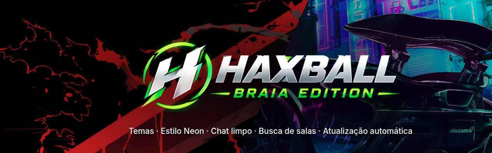
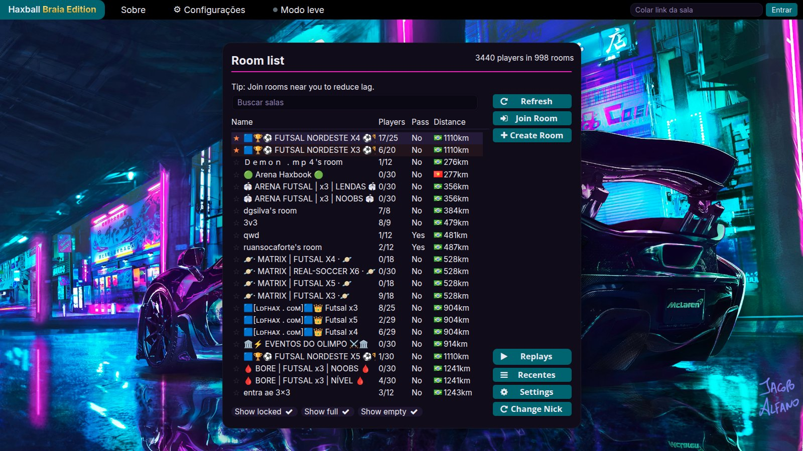
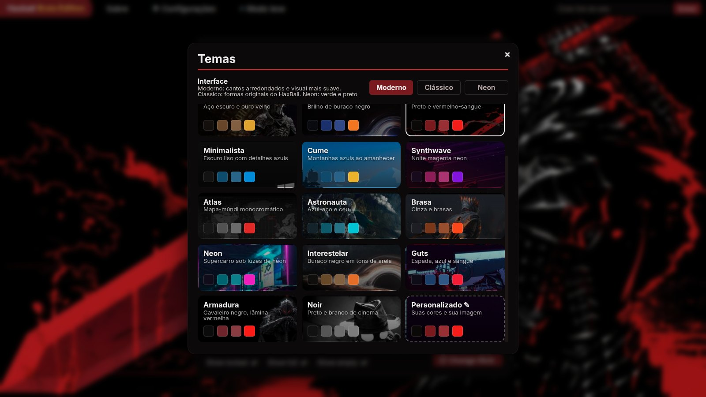
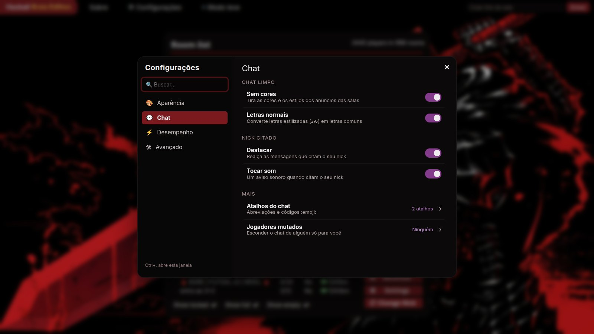
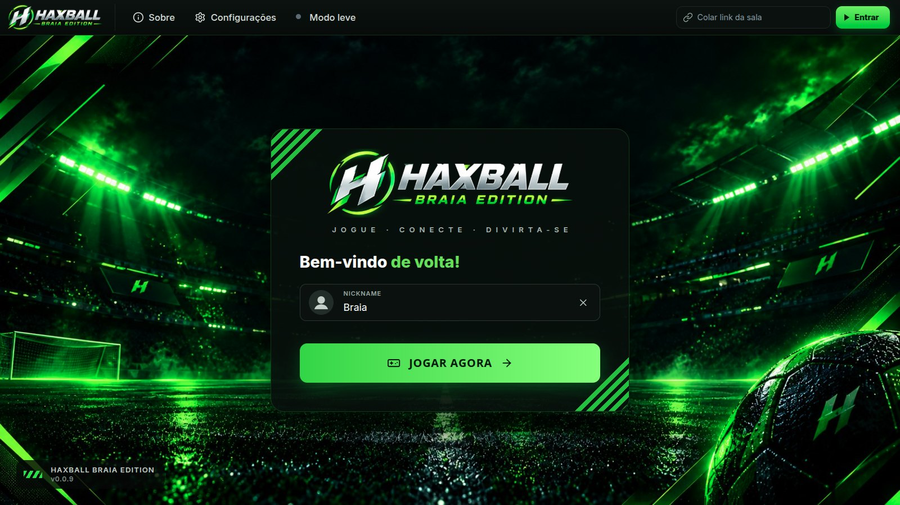
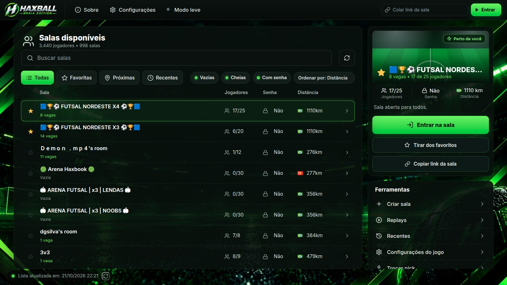

  

  
  
  

<h3 align="center">
  <a href="https://github.com/scard35/Haxball-Braia-edition/releases/latest">⬇️ Baixar a versão mais nova</a>
</h3>

 

  

## ✨ Recursos

<table>
  <tr>
    <td width="50%" valign="top">
      <h4>🎨 Temas</h4>
      16 temas com wallpaper e três estilos de interface: Moderno, Clássico e Neon. Ou crie o seu, com suas cores e sua própria imagem de fundo.
    </td>
    <td width="50%" valign="top">
      <h4>🟢 Estilo Neon</h4>
      Visual novo em verde e preto, com estádio de fundo e uma lista de salas com abas, filtros, ordem e a sala escolhida em destaque.
    </td>
  </tr>
  <tr>
    <td width="50%" valign="top">
      <h4>⚙️ Configurações</h4>
      Tudo num painel só, com busca: aparência, chat e desempenho. Abre pelo cabeçalho ou com <code>Ctrl+,</code>.
    </td>
    <td width="50%" valign="top">
      <h4>🧹 Chat limpo</h4>
      Tira as cores das mensagens das salas e transforma 𝐥𝐞𝐭𝐫𝐚𝐬 𝓮𝓼𝓽𝓲𝓵𝓲𝔃𝓪𝓭𝓪𝓼 em letras normais.
    </td>
  </tr>
  <tr>
    <td valign="top">
      <h4>🔇 Mute local</h4>
      Esconde o chat de um jogador só para você, em qualquer sala, até nas que mostram o chat como anúncio.
    </td>
    <td valign="top">
      <h4>💬 Atalhos do chat</h4>
      Abreviações como <code>/e</code> → <code>/extrapolation</code> e emojis por código, como <code>:smile:</code>.
    </td>
  </tr>
  <tr>
    <td valign="top">
      <h4>🔎 Busca de salas</h4>
      Encontre salas pelo nome, sem se preocupar com acentos e maiúsculas. Ou cole o link da sala no topo e entre direto.
    </td>
    <td valign="top">
      <h4>⭐ Favoritas e histórico</h4>
      Favorite salas com uma estrela e elas ficam no topo da lista. As últimas salas em que você entrou ficam a um clique.
    </td>
  </tr>
  <tr>
    <td valign="top">
      <h4>🪶 Modo leve</h4>
      Um clique tira wallpaper, desfoques e animações, para rodar liso em PC sem placa de vídeo boa.
    </td>
    <td valign="top">
      <h4>🔔 Nick citado</h4>
      Destaque e som quando alguém chama você no chat, até com letras estilizadas.
    </td>
  </tr>
  <tr>
    <td valign="top">
      <h4>🚀 Desempenho</h4>
      FPS desbloqueado com teto ajustável, extrapolation sem limites e nenhum anúncio carregando durante o jogo.
    </td>
    <td valign="top">
      <h4>🎬 Replays</h4>
      Abra com duplo clique ou arrastando para a janela. Os que você salva vão direto para Downloads e ficam em "Recentes".
    </td>
  </tr>
  <tr>
    <td valign="top">
      <h4>🔄 Sempre atualizado</h4>
      O app avisa quando sai versão nova e se atualiza sozinho.
    </td>
    <td valign="top">
      <h4>🛡️ Aviso de mudanças</h4>
      Se uma atualização do HaxBall afetar algum recurso, o app avisa o que parou.
    </td>
  </tr>
</table>

<table>
  <tr>
    <td width="50%"></td>
    <td width="50%"></td>
  </tr>
  <tr>
    <td align="center">Temas</td>
    <td align="center">Configurações</td>
  </tr>
</table>

## 🟢 Estilo Neon

Um visual novo em verde e preto. Escolha em **Configurações › Aparência › Estilo da interface**.

<table>
  <tr>
    <td width="50%"></td>
    <td width="50%"></td>
  </tr>
  <tr>
    <td align="center">Tela de entrada</td>
    <td align="center">Lista de salas</td>
  </tr>
</table>

## 📥 Instalação

| | Sistema | Arquivo |
|:-:|---|---|
| 🪟 | **Windows 10 e 11** | `Haxball-Braia-Edition-Setup-<versão>.exe`: abra e siga o instalador |
| 🐧 | **Linux** (Ubuntu, Mint, Debian) | `haxball-braia-edition_<versão>_amd64.deb`: abra na loja de apps ou rode `sudo apt install ./haxball-braia-edition_*.deb` |

Os dois estão em **[Releases](https://github.com/scard35/Haxball-Braia-edition/releases/latest)**.

> [!NOTE]
> No Windows, pode aparecer o aviso azul *"O Windows protegeu o computador"*. Clique em **Mais informações** e depois em **Executar assim mesmo**.

## 🔑 Ativação

Na primeira vez que abrir, o app pede uma **chave de ativação**. Cada chave ativa um PC. Peça a sua para o **Braia**.

 

© Braia · Haxball Braia Edition

