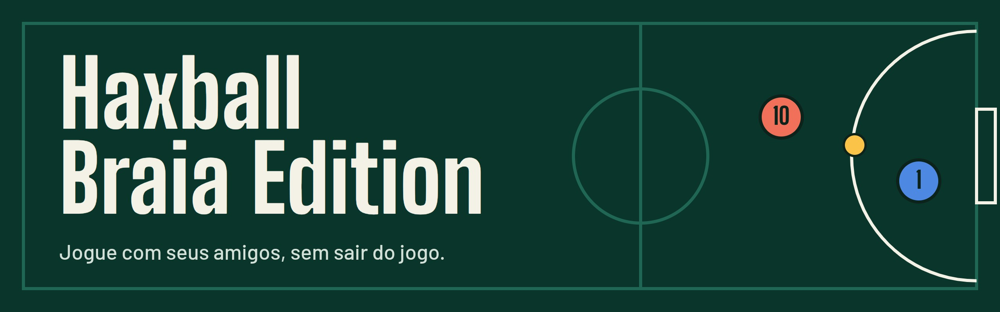
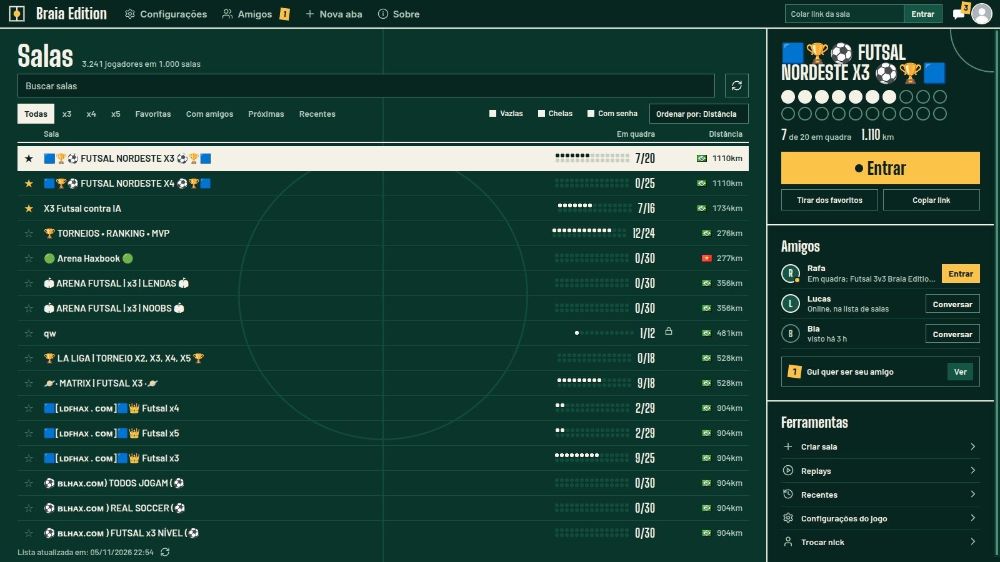
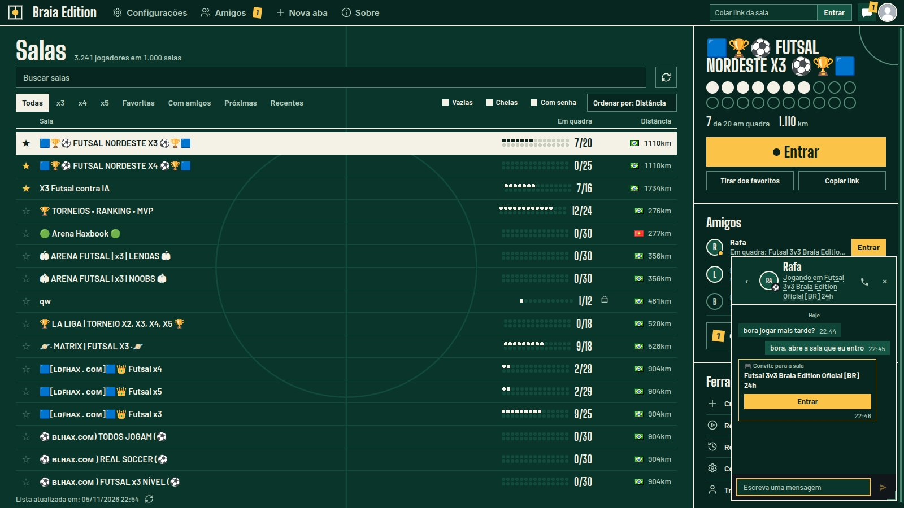
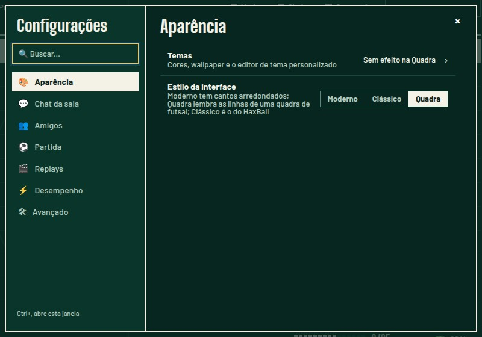
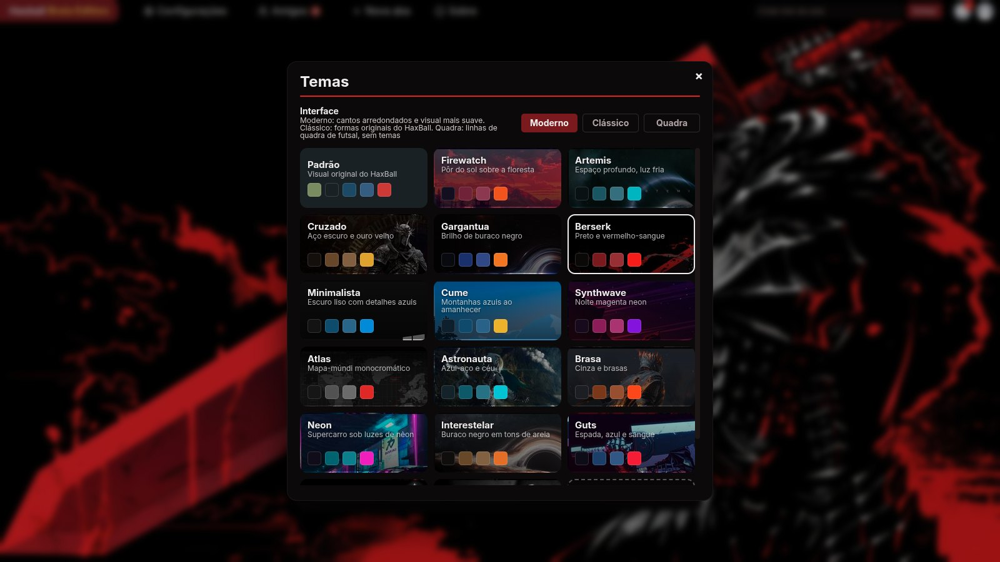

  

  
   Windows 10 e 11 · Linux (Ubuntu, Mint, Debian)

## Jogue com seus amigos

Veja em que sala cada amigo está e entre com um clique. Convide para a sua sala, converse e ligue sem sair do jogo.

<table>
  <tr>
    <td width="42%" align="center"></td>
    <td width="58%" valign="top">
      <b>Amigos</b> Código de amigo e busca por nome.  
      <b>Chat ao vivo</b> Numa janela que você move e redimensiona, ao lado do chat da sala.  
      <b>Convite</b> Um cartão com o nome da sala e o botão Entrar.  
      <b>Ligação de voz</b> Entre dois amigos, mesmo trocando de sala.
    </td>
  </tr>
</table>

## Ache a sala certa

<table>
  <tr>
    <td width="33%" valign="top"><b>Lugares à vista</b> Cada sala mostra quantos estão em quadra.</td>
    <td width="33%" valign="top"><b>Filtros</b> x3, x4, x5, favoritas, com amigos, próximas e recentes.</td>
    <td width="33%" valign="top"><b>Sala cheia</b> O app espera a vaga e entra para você.</td>
  </tr>
  <tr>
    <td valign="top"><b>Busca</b> Pelo nome, sem se preocupar com acentos e maiúsculas.</td>
    <td valign="top"><b>Link direto</b> Cole o link da sala no topo do app.</td>
    <td valign="top"><b>Abas</b> Várias salas ao mesmo tempo, cada uma conectada.</td>
  </tr>
</table>

## Durante a partida

<table>
  <tr>
    <td width="50%" valign="top"><b>Aviso de entrar em campo</b> Com o app minimizado, som e pop-up quando colocam você num time ou a partida começa.</td>
    <td width="50%" valign="top"><b>Chat limpo</b> Tira as cores dos anúncios e transforma 𝓵𝓮𝓽𝓻𝓪𝓼 𝓮𝓼𝓽𝓲𝓵𝓲𝔃𝓪𝓭𝓪𝓼 em letras normais.</td>
  </tr>
  <tr>
    <td valign="top"><b>Nick citado</b> Destaque e som quando chamam você no chat.</td>
    <td valign="top"><b>Mute local</b> Esconde o chat de um jogador só para você, em qualquer sala.</td>
  </tr>
  <tr>
    <td valign="top"><b>Replays</b> Duplo clique para abrir, gols marcados na barra de tempo e lance salvo em vídeo.</td>
    <td valign="top"><b>Modo streamer</b> Esconde o link, a senha e o nome da sala para quem assiste.</td>
  </tr>
</table>

## Do seu jeito

<table>
  <tr>
    <td width="50%"></td>
    <td width="50%"></td>
  </tr>
  <tr>
    <td valign="top"><b>Estilo Quadra, Moderno ou Clássico</b> Configurações reúne tudo, com busca. Abra pela barra de cima ou com <code>Ctrl+,</code>.</td>
    <td valign="top"><b>16 temas com wallpaper</b> Nos estilos Moderno e Clássico. Ou crie o seu, com suas cores e sua imagem.</td>
  </tr>
</table>

**Modo leve** para PC fraco, **FPS** com teto ajustável, nenhum anúncio durante o jogo e **atualização automática**: o app avisa quando sai versão nova e se atualiza sozinho.

## Como instalar

Baixe em **[Releases](https://github.com/scard35/Haxball-Braia-edition/releases/latest)**:

| Sistema | Arquivo | Como instalar |
|---|---|---|
| **Windows 10 e 11** | `Haxball-Braia-Edition-Setup-<versão>.exe` | Abra e siga o instalador |
| **Linux** (Ubuntu, Mint, Debian) | `haxball-braia-edition_<versão>_amd64.deb` | Abra na loja de apps, ou rode `sudo apt install ./haxball-braia-edition_*.deb` |

> [!NOTE]
> No Windows, pode aparecer o aviso azul *"O Windows protegeu o computador"*. Clique em **Mais informações** e depois em **Executar assim mesmo**.

Na primeira vez, o app pede uma **chave de ativação**. Cada chave ativa um PC. Peça a sua para o **Braia**.

 

© Braia · Haxball Braia Edition

