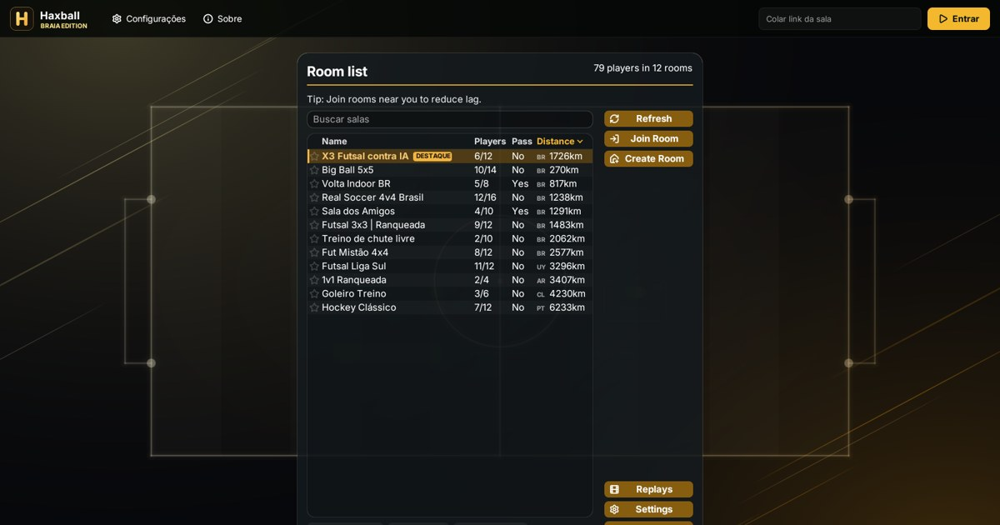

  

<h3 align="center">
  <a href="https://scard35.github.io/Haxball-Braia-edition/">Ver a página do app</a>
  &nbsp;·&nbsp;
  <a href="https://github.com/scard35/Haxball-Braia-edition/releases/latest">Baixar a versão mais nova</a>
</h3>

Grátis · Windows 10 e 11 · Linux (Ubuntu, Mint, Debian, Arch) · Android 7+

© Braia · Haxball Braia Edition · App não oficial; o HaxBall é de basro.

